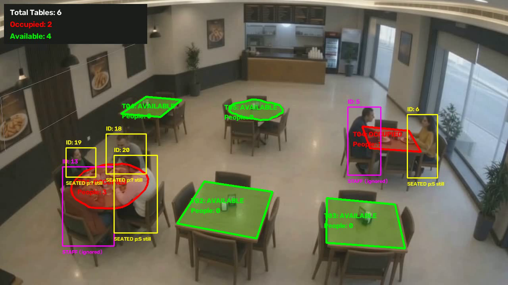

<div align="center">

# 🍽️ TableVision

### Turn existing restaurant CCTV into live table-occupancy insights




</div>

---

## Overview

Most restaurants already have CCTV cameras. **TableVision** is an experimental computer vision prototype that analyzes that footage to detect and track people, assign them to tables, and show which tables are free or taken, with no new hardware.

> ⚠️ **Status:** Experimental prototype. Occupancy and guest counts are estimates and may be inaccurate in some scenes. See [Limitations](#limitations).

## Features

| | |
|---|---|
| 🧍 **Pose detection** | Detects people and body pose with YOLO26 Pose |
| 🔁 **Tracking** | Keeps identities consistent across frames with ByteTrack |
| 🗺️ **Table zones** | Manually drawn polygons per table for each camera view |
| ⏱️ **Temporal confirmation** | Confirmation and exit timers reduce short-lived false assignments |
| 🧑‍🍳 **Staff filtering** | Staff filtering and ignore zones for areas like walkways |
| 🎥 **Annotated output** | Exports video with table states and estimated guest counts |

## Table states

| State | Meaning |
|---|---|
| 🟢 **Available** | No confirmed seated guests assigned to the table |
| 🟡 **Checking** | Evaluating, or waiting on a confirmation/exit timer |
| 🔴 **Occupied** | One or more guests passed the seating confirmation logic |

Thresholds and timings are configurable in `src/occupancy.py`.

## How it works

```text
CCTV video → YOLO26 Pose → ByteTrack → pose & movement analysis
           → table-zone assignment → occupancy state → annotated video
```

The occupancy logic combines proximity to each table polygon, pose cues, movement history, and confirmation/exit timers to estimate whether guests are actually seated.

## Quick start

**Requirements:** Python 3.10+, a CPU for basic runs (NVIDIA GPU with CUDA recommended for speed), and OpenCV display support for the zone annotation tool.

```bash
git clone https://github.com/ahmaddii/TableVision
cd TableVision

python -m venv .venv
source .venv/bin/activate        # Windows: .venv\Scripts\activate

python -m pip install ultralytics opencv-python numpy torch lap
```

Make sure the model weights (`yolo26s-pose.pt`) and your input video are available at the paths set in the scripts.

### 1. Draw table zones

Set the video and output paths in `src/table_zones.py`, then run:

```bash
python src/table_zones.py
```

Save the zones as JSON (default: `outputs/table_zones_1.json`). Each camera view needs its own zones; if the camera position or zoom changes, redraw them.

### 2. Process a video

In `src/occupancy.py`, check these settings:

| Setting | Purpose | Default |
|---|---|---|
| `MODEL_PATH` | Pose model weights | `yolo26s-pose.pt` |
| `ZONES_PATH` | Table zone file for your camera | `outputs/table_zones_1.json` |
| `OUTPUT_PATH` | Annotated video output | `outputs/restaurant_occupancy.mp4` |

Then run:

```bash
python src/occupancy.py
```

Open the result in any video player, such as VLC.

## Project structure

```text
.
├── assets/             # README demo image
├── data/
│   ├── images/         # Demo footage
│   └── videos/         # Test videos
├── outputs/            # Table-zone JSON and generated video
├── src/
│   ├── detector.py     # Person detection
│   ├── occupancy.py    # Occupancy pipeline and configuration
│   ├── table_zones.py  # Table polygon annotation tool
│   ├── tracker.py      # Tracking helpers
│   └── video.py        # Camera/video input experiment
├── yolo26s-pose.pt     # Pose model weights
└── yolo26n.pt          # Detection model weights
```

## Limitations

- **Occlusion** by people, tables, and furniture reduces accuracy.
- **Camera angle, lighting, and image quality** affect zone assignment and pose estimates.
- **Staff vs. guests** can be confused; filtering depends on the scene and configuration.
- **Tracking IDs** can change between runs.
- **Performance** depends on input resolution and hardware.
- **Sample or generated footage** is not a substitute for testing on real restaurant video.

## Roadmap

- [ ] Better person-to-table association and seated-person classification
- [ ] Multi-camera support with clearer configuration
- [ ] Evaluation on authorized, representative restaurant footage
- [ ] Real-time camera stream support
- [ ] Dashboard: live availability, utilization, occupancy trends, waiting-time insights

## Privacy and responsible use

Use camera footage only with proper authorization. Follow applicable privacy requirements, limit access to video and derived data, and validate the system carefully before relying on its estimates for operational decisions.

## Contributing

Feedback, issues, and pull requests are welcome. If you work in restaurants, hospitality tech, or computer vision, I'd love to hear what would make this useful in the real world.

## Author

**Ahmad** — Computer Vision, Machine Learning, and Software Engineering
